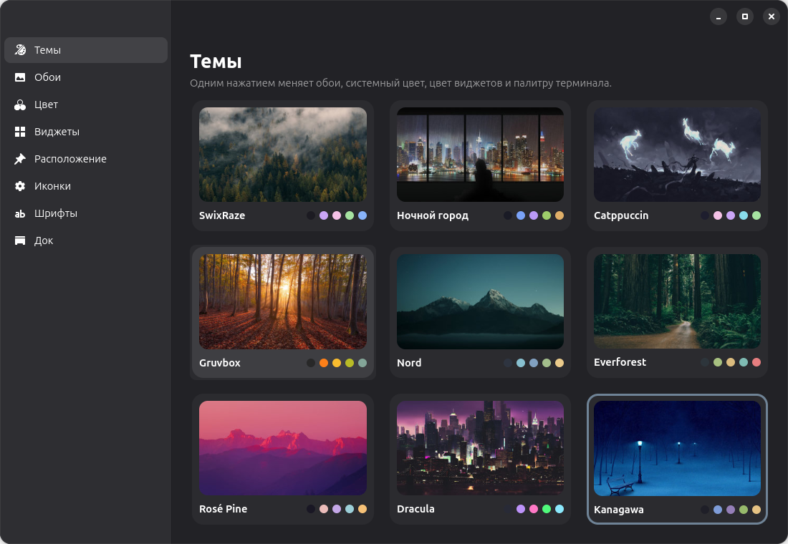
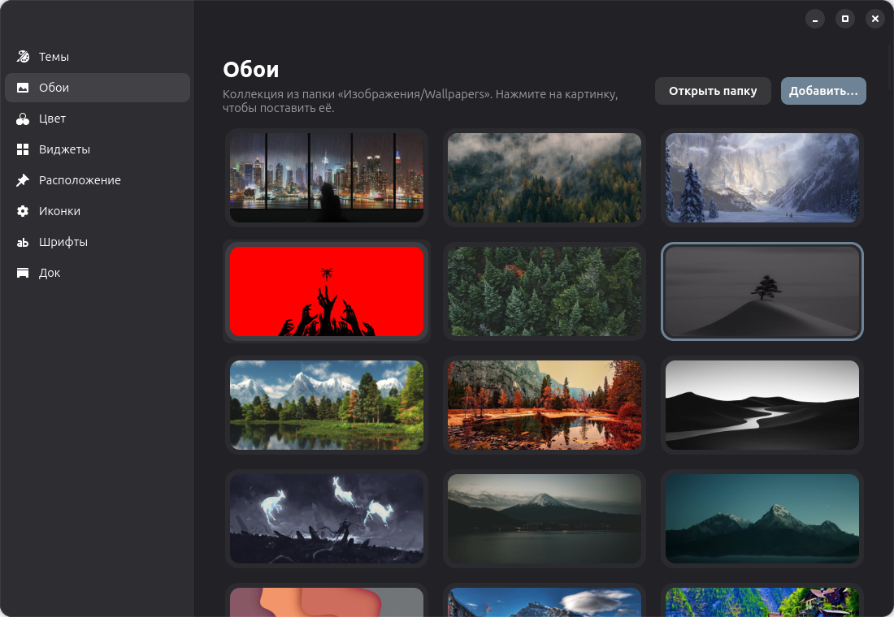
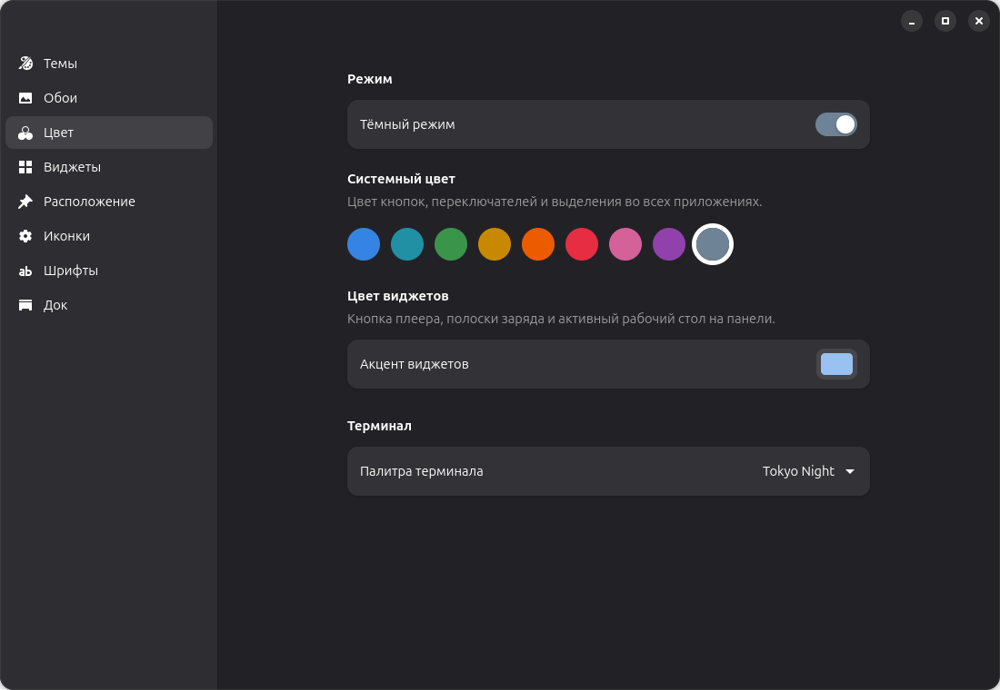
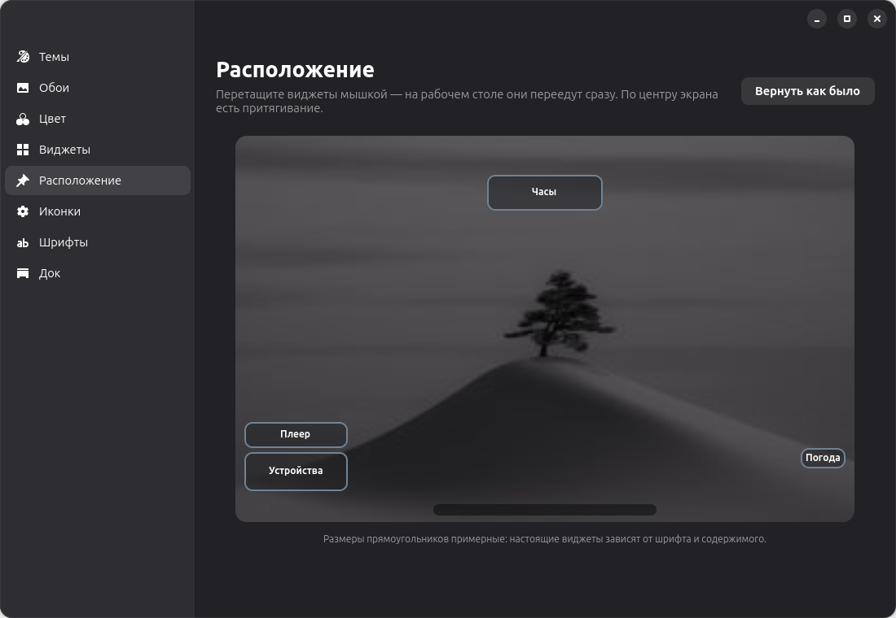
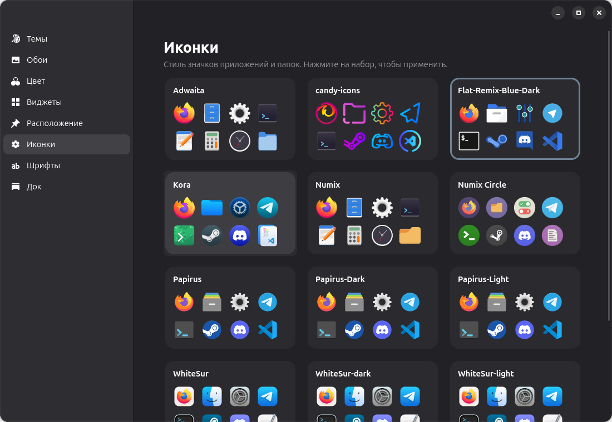
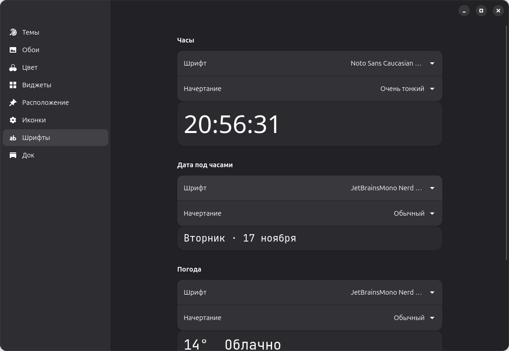

# SwixRaze

**Смешай стиль. Снеси скучное.**

SwixRaze — оформление рабочего стола GNOME в одном приложении: темы, обои, системный цвет,
шрифты, иконки и виджеты на рабочем столе и экране блокировки. Всё меняется мышкой, без терминала.

Название: **Swix** — *swift + mix*, быстро смешивать стили; **Raze** — снести скучный стандартный вид.



## Что умеет

- **Темы** — одним нажатием меняют обои, системный цвет, цвет виджетов и палитру терминала:
  SwixRaze, Ночной город, Catppuccin, Gruvbox, Nord, Everforest, Rosé Pine, Dracula, Kanagawa.
- **Обои** — галерея с миниатюрами, добавление своих картинок.
- **Цвет** — тёмный режим, системный акцентный цвет, цвет виджетов, палитра терминала Ptyxis.
- **Виджеты** — большие часы, погода (город ищется по-русски), карточки плеера (MPRIS: обложка,
  название, кнопки), устройств (заряд наушников, мыши, ноутбука через UPower) и системы
  (процессор, память, температура).
- **Экран блокировки** — карточки в ряд внизу экрана, лёгкое размытие фона, выбор аватара.
- **Расположение** — схема экрана, на которой виджеты перетаскиваются мышкой.
- **Иконки** — выбор набора иконок с предпросмотром.
- **Шрифты** — свой шрифт и начертание для часов, даты, погоды и карточек.
- **Док** — автоскрытие, размер иконок, прозрачность, положение.

| Обои | Цвет | Расположение |
|---|---|---|
|  |  |  |

| Иконки | Шрифты |
|---|---|
|  |  |

## Требования

- GNOME Shell 48–51, сеанс Wayland. Проверено на Ubuntu 26.04 (GNOME 50).
- Python 3 с GTK 4, libadwaita и GWeather:

```bash
sudo apt install python3-gi gir1.2-gtk-4.0 gir1.2-adw-1 gir1.2-gweather-4.0 dconf-cli git curl fontconfig
```

## Установка

```bash
git clone https://github.com/mrKirillos-swix/SwixRaze.git
cd SwixRaze
./install.sh
```

Установщик ставит всё в домашнюю папку, `sudo` не нужен. Про каждую необязательную часть он спросит отдельно:

| Часть | Откуда |
|---|---|
| Desktop Widgets — нужен для часов и погоды | extensions.gnome.org (GNOME покажет окно подтверждения) |
| Blur my Shell, Just Perfection, Space Bar, Rounded Window Corners | extensions.gnome.org |
| Шрифты Inter, Manrope, Montserrat, Onest, Rubik, Comfortaa, Unbounded | Google Fonts (OFL) |
| JetBrains Mono Nerd Font | Nerd Fonts (OFL / MIT) |
| Коллекция обоев (~360 МБ) | github.com/ilyamiro/shell-wallpapers |
| Иконки Kora, Candy, Numix Circle, Zafiro | их репозитории на GitHub (GPL-3.0) |

`./install.sh --all` поставит всё без вопросов, `./install.sh --minimal` — только сам SwixRaze.

**После установки выйдите из системы и войдите снова** — GNOME на Wayland загружает новые расширения только при входе.
Потом откройте «SwixRaze» в меню приложений.

### Что куда ставится

| Что | Куда |
|---|---|
| Приложение | `~/.local/share/swixraze/` и ярлык в `~/.local/share/applications/` |
| Расширение с карточками | `~/.local/share/gnome-shell/extensions/swixraze-widgets@mrKirillos-swix/` |
| Палитра терминала | `~/.local/share/org.gnome.Ptyxis/palettes/SwixRaze.palette` |
| Настройки | `~/.config/swixraze/config.json` |

## Удаление

```bash
./uninstall.sh
```

Сторонние расширения, шрифты, обои и иконки остаются — их можно удалить отдельно.

## Известные ограничения

- Интерфейс пока только на русском.
- Виджеты передвигаются на схеме в приложении, а не прямо на рабочем столе:
  перетаскивание на самом столе в GNOME 50 возможно только через внутренние механизмы GNOME, которые ломаются при обновлениях.
- Карточки на экране блокировки занимают низ экрана, поэтому уведомления GNOME там лучше выключить
  (переключатель есть во вкладке «Виджеты»), иначе будет два плеера.
- Расположение экрана блокировки GNOME менять нельзя: пароль всегда по центру.
- Темы с обоями работают, только если скачана коллекция обоев; без неё тема меняет всё, кроме обоев.

## Благодарности и лицензии

- Вдохновлено оболочкой [Serpantinum](https://github.com/ilyamiro/serpantinum) от ilyamiro. SwixRaze — отдельный проект и не использует её код.
- Обои — [ilyamiro/shell-wallpapers](https://github.com/ilyamiro/shell-wallpapers). У коллекции нет лицензии,
  поэтому SwixRaze их не распространяет: они скачиваются по желанию и принадлежат своим авторам.
- Палитры тем основаны на Catppuccin, Gruvbox, Nord, Everforest, Rosé Pine, Dracula, Kanagawa и Tokyo Night.
- Часы и погода работают через [Desktop Widgets](https://gitlab.com/AndrewZaech/azclock).

Код SwixRaze распространяется по лицензии **GNU GPL v3** — см. [LICENSE](LICENSE).
